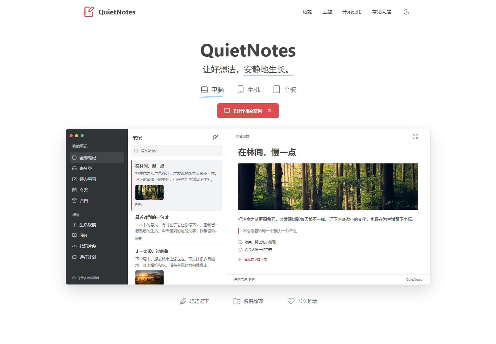

# QuietNotes

**安静但有辨识度的笔记视觉，做成可以直接使用的前端 skill。**

[首页预览地址](https://maile456.github.io/QuietNotes/) · [功能工作区地址](https://maile456.github.io/QuietNotes/workspace/) · [Skill](SKILL.md) · [设计规范](references/design-system.md) · [源码](docs/)

> 上方为 GitHub Pages 发布地址规划，当前部署状态以仓库 Pages 设置和实际访问结果为准。尚未在本文声明已部署。



## 这是什么

QuietNotes 是一个面向 AI 编程助手的前端设计 skill。视觉参考 [Bear](https://bear.app/)，这一版着重接近参考站的构图、字号层级、配色、产品展示方式与页面节奏，而非只抽取“极简”或“黑白”等抽象标签。

核心签名：**白底无衬线、珊瑚红点色、设备切换与三栏笔记预览**。保留原创品牌、文字、交互与素材，不包含参考产品的商标、官网源码或专有字体，也不表示与参考产品存在合作关系。

适合博客、个人主页、笔记产品、阅读和写作工具。已有 React、Vue 或其他项目优先保留原有框架、功能与数据契约。

## 两层样品

| 入口 | 内容 |
| --- | --- |
| [`docs/index.html`](docs/index.html) | 笔记产品首页，含设备预览、笔记搜索、新建本地笔记与主题切换 |
| [`docs/workspace/index.html`](docs/workspace/index.html) | maile123 的中文个人博客 |

首页用于检视风格与构图；工作区保留完整的任务流程，适合检视这种视觉如何落到实际应用。

工作区可操作内容：文章搜索、分类筛选、本地收藏、阅读弹层、目录与明暗主题。样品使用演示数据或本地状态，不连接生产业务服务。

## 安装到 Codex

Windows PowerShell：

```powershell
$skillRoot = if ($env:CODEX_HOME) { Join-Path $env:CODEX_HOME 'skills' } else { Join-Path $env:USERPROFILE '.codex\skills' }
New-Item -ItemType Directory -Path $skillRoot -Force | Out-Null
git clone https://github.com/maile456/QuietNotes.git (Join-Path $skillRoot 'quiet-notes')
```

macOS / Linux：

```sh
skill_root="${CODEX_HOME:-$HOME/.codex}/skills"
mkdir -p "$skill_root"
git clone https://github.com/maile456/QuietNotes.git "$skill_root/quiet-notes"
```

目标已有内容时 Git 会停止，不覆盖现有 skill。安装后在下一轮对话调用；若列表尚未更新，重新打开对话。

```text
使用 $quiet-notes 为我的项目设计前端。
按参考风格的构图、字体层级和产品展示方式完成页面，
保留我的品牌、已有框架与功能，做好响应式与真实交互。
```

## 运行与复用

直接打开 `docs/index.html` 查看首页，打开 `docs/workspace/index.html` 体验工作区，无需安装依赖。

复制到尚不存在的新目录时，使用 Node.js 18+：

```sh
node scripts/scaffold.mjs --dest "<尚不存在的新目录绝对路径>"
```

在本仓库执行资源和语法检查：

```sh
npm run check
```

该命令不等同于浏览器交互或视觉检查；实际检查范围与状态见 [验证记录](QA.md)。

<details>
<summary>手机展示</summary>


</details>

## 目录

- `SKILL.md`：skill 入口与关键设计决策。
- `references/`：参考签名、尺寸、布局和状态规范。
- `assets/tokens.css`：可移植设计变量。
- `docs/`：官网风格首页、字体、媒体与本地依赖，也是 Pages 发布目录。
- `docs/workspace/`：完整功能样品。
- `scripts/`：新目录复制和资源检查。

## 许可与素材

原创代码和规范使用 [MIT](LICENSE)。Lucide、字体及照片保持各自许可，见 [第三方与素材说明](THIRD_PARTY_NOTICES.md)。照片不重新授权为 MIT。原创生成插画与原创代码模型有独立来源说明，不使用参考产品的官方媒体。

## 同系列

- [Clearfolio](https://github.com/maile456/Clearfolio)：清晰、轻盈的文档产品视觉。
- [QuietNotes](https://github.com/maile456/QuietNotes)：安静但有辨识度的笔记视觉。
- [KindForm](https://github.com/maile456/KindForm)：友好、轻巧的表单产品视觉。
- [MonoSignal](https://github.com/maile456/MonoSignal)：黑白、精密的开发者产品视觉。
- [CalmConsole](https://github.com/maile456/CalmConsole)：清爽、一致的组件系统视觉。

